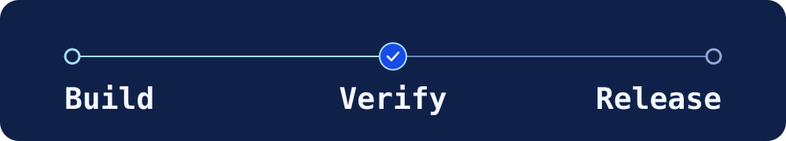

# Steffen Kwik

I build full-stack products and AI automation at Different Network. I work on product requirements, implementation review, and release verification, using AI coding tools as part of development.

## Selected work

- **[Different Network Transcribe](https://github.com/steffenkwik/different-network-transcribe)** — Python desktop application for local audio transcription. Explore the public source, packaging, and documentation.
- **[Reliability patterns](https://github.com/steffenkwik/reliability-patterns)** — Run the Python and SQLite tests for duplicate delivery, rollback, retries, and concurrent writes. Uses synthetic records.
- **[Engineering portfolio](https://steffenkwik.github.io/engineering-portfolio/)** — Six case studies and an interactive reliability demo, with [the source on GitHub](https://github.com/steffenkwik/engineering-portfolio).
- **[Indonesian AI curriculum sentiment dataset](https://github.com/steffenkwik/indonesia-coding-ai-sentiment)** — Research dataset with documented labels, evaluation folds, and contributor attribution.

I work primarily with TypeScript, React, Cloudflare Workers, Python, and SQL.
